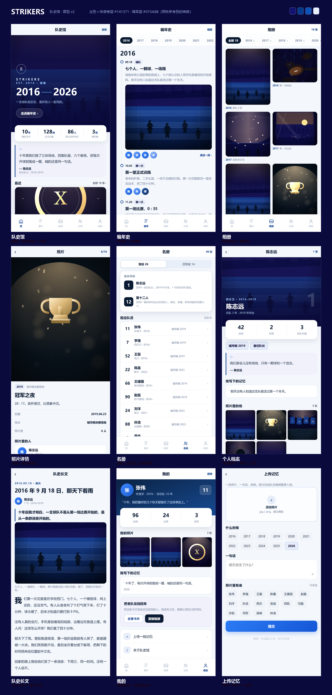

# Strikers 队史馆 · 纪念版

给 Strikers 橄榄球队现役队员、以及已经毕业的老队员的一个**纪念型小程序**：把十年里的照片、编年史、名册、长文和那些说不清的小事收进一个地方。

现役的人在这里看到自己，离开的人在这里找到自己。训练侧的工具属性降到辅助位置。

---

## 先看这里：这个仓库有两个版本

| 分支 | 是什么 | 状态 |
| --- | --- | --- |
| `main` | **v1 训练工具方向** —— 接龙导入、手动点名台、伤病档案、出勤统计；PRD v1.2 + 9 张设计稿 + HTML 可交互原型 | 完整保留，随时可以 checkout 回去 |
| `memorial` ← 当前分支 | **v2 纪念版** —— 队史馆原型，10 条路由 | 本分支的全部内容 |

两版共用同一套设计语言（蓝色主色、圆角、字号、组件），差别在产品重心：v1 解决「谁来了、来了几次」，v2 解决「我们是谁、后来呢」。

---

## 30 秒看到效果

没有任何构建步骤、没有依赖，**本地 clone 之后双击就能开**（GitHub 网页上点 `.html` 只会显示源码，截图和 Markdown 可以直接看）。

| 想看的 | 打开 |
| --- | --- |
| 落地页（导航到所有东西） | 本地双击 [`index.html`](index.html) |
| **队史馆原型**（10 条路由，可点） | 本地双击 [`memorial/index.html`](memorial/index.html) |
| 数据自检页（给开发者和智能体看） | 本地打开 `memorial/index.html?selftest=1` |
| 九屏总览图 | [`memorial/out/board9.png`](memorial/out/board9.png) |
| 训练侧原型（v1，保留） | 本地双击 [`prototype/index.html`](prototype/index.html) |
| 9 张设计稿 | 本地双击 [`design/mockups.html`](design/mockups.html) |



---

## 队史馆做了什么

**5 个 Tab：馆 / 编年 / 相册 / 名册 / 我的**

| 页面 | 内容 |
| --- | --- |
| `#/home` 队史馆 | 封面（2016—2026）、四个数字（10 年 / 128 场 / 86 人 / 3 冠）、首任队长引言、最近的大事件、横滑影像、毕业墙、纪录、随机翻一页 |
| `#/timeline` 编年史 | 年份条 + 竖向时间轴，18 条事件，每条带照片、参与人、「读这一段 →」 |
| `#/album` 相册 | 年份筛选（含各年张数）+ 双列瀑布 |
| `#/photo/:id` 照片详情 | 大图、拍摄信息、照片里的人、上一张 / 下一张 |
| `#/roster` 名册 | 现役 26 / 已毕业 14，退役号码 1 号（陈志远）与 12 号（第十二人） |
| `#/person/:id` 个人档案 | 号码水印、三格数字、荣誉、他的一句话、照片里的他、他经历过的队史事件 |
| `#/story/:id` 队史长文 | serif 正文、首字下沉、内联照片、引用、落款 |
| `#/me` 我的 | 我的照片、我写下的记忆、「把老队友找回来」 |
| `#/submit` 上传记忆 | 照片位、年份、一句话、照片里有谁 |
| `#/selftest` 数据自检 | 把 `validate()` 的结果渲染成表格 |

演示数据：2016–2026 十年、40 位成员、18 条编年、18 张照片、4 篇长文、6 条记忆。**全部是评审用虚构内容**，照片是内联 SVG 占位图。

---

## 配色

蓝白主色不变，但按球队指定的两枚参考色重标了蓝色：

| Token | 值 | 用途 |
| --- | --- | --- |
| `--brand-900` | `#0B0A3D` | 最深底色、`theme-color` |
| `--brand-800` | `#141371` 突袭者蓝 `rgb(20,19,113)` | 封面 / 个人页渐变、夜空、照片暗部、球衣 |
| `--brand-700` | `#073A8B` 海军蓝 `rgb(7,58,139)` | 链接、按钮、选中态、时间轴节点、标签 |
| `--brand-600` | `#0F52B5` | 更亮一档的强调 |
| `--brand-100` | `#E7EDF9` | 浅底卡片、标签底 |

- 语义色（出勤绿 `#0FA968`、迟到琥珀 `#F5A524`、缺席红 `#E5484D`）保持不变；
- token 覆盖写在 [`memorial/memorial.css`](memorial/memorial.css) 末尾，基线 [`memorial/styles.css`](memorial/styles.css) 与 v1 原型**逐字节同源**，可以直接 `diff` 回归。

---

## 自检与出图

```bash
node memorial/check.mjs     # 数据校验：引用完整性 / 唯一 id / 日期与年份一致 / 号码不重复
node memorial/smoke.mjs     # 无浏览器冒烟测试：11 条路由逐条渲染并断言关键文案
```

```powershell
cd memorial
.\shot.ps1                    # 10 张 860×1800 截图
.\shot.ps1 person,me          # 只出指定页面
python build_board.py         # 拼 3×3 总览图 out/board9.png
```

三件事同一套逻辑：`data.js` 里的 `validate()` 同时供**浏览器自检页**和**命令行脚本**使用，所以「页面里过了 = 命令行也过了」。
> 注意：本机 Chrome 在受限沙箱下无法启动（命名管道被拒），截图脚本需要提权执行。

---

## 目录结构

```
├── index.html                    落地页：原型 / 设计稿 / 文档入口
├── memorial/                     队史馆原型（本版本的主角）
│   ├── index.html                壳：一份样式基线 + 一份扩展层
│   ├── styles.css                与 v1 原型逐字节同源的基线样式
│   ├── memorial.css              队史馆扩展层（含品牌蓝覆盖、照片调色）
│   ├── data.js                   数据 + validate()，浏览器与 node 同源
│   ├── app.js                    路由、渲染、事件委托、SVG 占位照片
│   ├── check.mjs / smoke.mjs     命令行自检与冒烟测试
│   ├── shot.ps1 / crop.py        截图与裁剪
│   ├── build_board.py            九屏总览图
│   ├── README.md                 原型说明：路由表、数据结构契约、怎么加内容
│   └── out/                      截图产物（board9.png 是总览）
├── prototype/                    训练侧原型 v1（接龙 → 点名 → 统计）
├── design/                       设计稿：8 页 + 设计规范
├── PRD.md / ROADMAP.md / RISKS.md  训练侧需求与风险（v1 内容，尚未改写成队史馆）
```

---

## 还没做的（诚实清单）

- **队史馆的 PRD 尚未成文**：现在的原型是「设计先行」，需求只有口头的四条（照片、编年史、球队记忆、大事件）；
- **数据是假的**：40 位成员、18 条编年都是虚构的，接真内容前需要先定「谁能上传、谁审核、老队员怎么认领号码」；
- **照片是 SVG 占位**：接真照片时删掉 `memorial.css` 末尾的「照片调色」段、把 `photoBox()` 换成 `image` 组件即可；
- **还没起小程序工程**：`miniprogram/` 与 `cloudfunctions/` 都还没有，迁移路径写在 [`memorial/README.md`](memorial/README.md)；
- **训练侧的 PRD / ROADMAP / RISKS 仍是 v1 原文**，与纪念版重心不一致，需要时再改。

---

## 跨机器协作

仓库：<https://github.com/DA77ashyt/mini_strikers>（私有）

```powershell
git clone https://github.com/DA77ashyt/mini_strikers.git
cd mini_strikers
git checkout memorial      # 看纪念版；不带这个参数就是 v1 的 main
```

Windows 上推送前先开代理（git 配的是 `http.proxy=127.0.0.1:7890`），并确认
`git config --global credential.helper manager`，这样走浏览器登录、不用手输 token。

---

## 下一步

1. **让队里看真东西**：挑 20 张真照片 + 1 篇真人写的长文，验证「录入成本」能不能接受；
2. **写队史馆 PRD**：先定审核与认领，再谈功能；
3. **转小程序**：一页对一页建 WXML，两份 CSS 转两份 WXSS，`data.js` 的集合直连云数据库集合。
